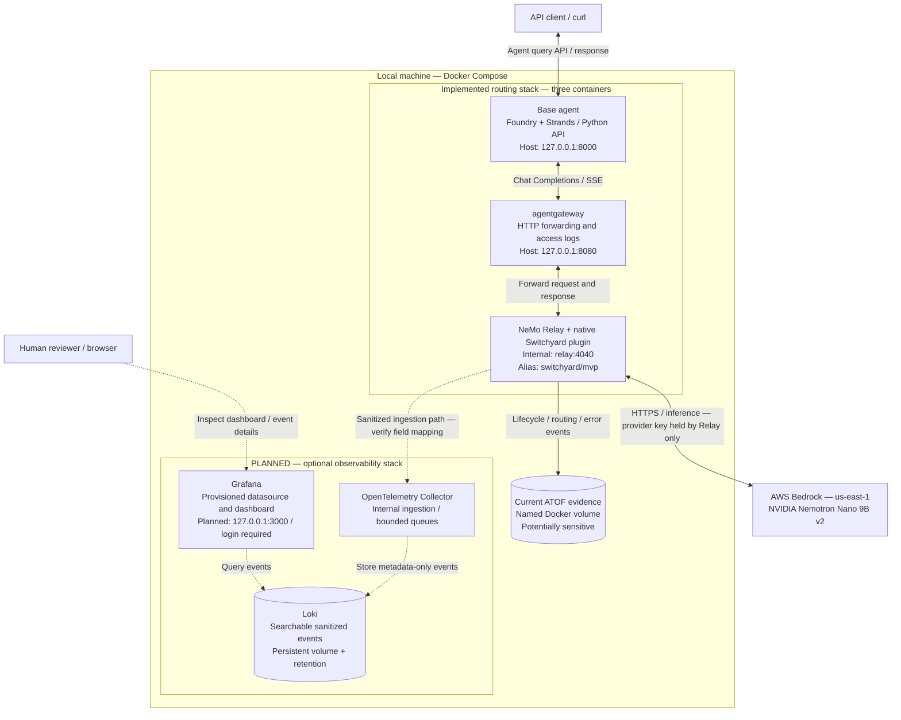

# Switchyard Relay Gateway

A local Docker experiment for sending a base agent's model requests through
**agentgateway → NVIDIA NeMo Relay with Switchyard → AWS Bedrock**, with a planned
containerized Grafana stack for human inspection of routing telemetry.

This is the **whole-project README**. The inherited Python agent is one
component; its setup and extension overview lives in the separate
[base-agent README](BASE_AGENT_README.md).

## Architecture

Solid connections show the implemented routing/evidence configuration.
Dashed connections show **planned observability work**, not running services.
The routing configuration still requires live Docker/Bedrock validation; the
diagram is not a claim of successful deployment.

The model runs in AWS, not in Docker. Switchyard is a native plugin **inside
Relay**, not a fourth routing container. Responses return through the same
routing services; ordinary and streaming API paths are both part of acceptance.

### Component responsibilities

| Component | Responsibility |
|---|---|
| Base agent | Accept queries and manage model interactions through the NIMS/OpenAI-compatible adapter |
| agentgateway | Forward the HTTP route, apply deadlines, and emit access records; no model selection |
| Relay + Switchyard | Load the plugin, resolve the model alias, call the provider, and emit telemetry |
| Bedrock | Authenticate provider requests and run the configured target model |
| Collector — planned | Ingest and forward sanitized events with bounded buffering |
| Loki — planned | Persist and query events; request IDs remain searchable fields rather than high-cardinality index labels |
| Grafana — planned | Provide authenticated human inspection, filters, and event drill-down |

The current route is deterministic passthrough:
`switchyard/mvp` → `nvidia.nemotron-nano-9b-v2` in `us-east-1`.
There is no classifier, fallback model, Ollama, enabled tool set, or persistent
agent memory in this MVP.

### Telemetry boundaries

Current ATOF evidence is separate from the planned searchable store.
`enable_full_payloads = false` does **not** guarantee content-free telemetry.
The observability work must enforce metadata-only capture before durable
storage/export, including any existing file sink.

The planned ingestion path prefers native OTLP logs if they preserve the needed
fields. Otherwise it must use one verified sanitized ATOF ingestion path—not
both and not an assumption that every ATOF event becomes an OTLP log.

Grafana, Loki and the Collector are planned as an opt-in profile/overlay so
routing-only use remains available. Only Grafana's authenticated UI will be
published on loopback; Loki and Collector ingestion remain internal.
Named volumes provide restart persistence, **not backups**. Tempo, Prometheus,
S3 archival, remote telemetry export and production deployment are out of scope
for this phase.

## Start and test the routing stack

Follow the [local routing runbook](local-routing/README.md) for prerequisites,
secure local `.env` setup, build/start/health commands, API examples, live smoke
tests, shutdown and cleanup.

**Use the Compose configuration in `local-routing/`, not the inherited root
Compose file.** The Bedrock credential belongs only in ignored local secret
configuration; never put it in Git, a command example, an issue or chat.

Docker builds/runtime, ARM64 execution and successful live Bedrock inference
remain unverified in the recorded development environment. Native Linux AMD64
tests demonstrated plugin activation, gateway forwarding and provider-error
propagation through both agent endpoints. The runbook records exact checks and
remaining blockers. Grafana services have been planned, not implemented.

## Documentation

| Read this | For |
|---|---|
| [Routing runbook](local-routing/README.md) | Environment setup, service operation, API tests and validation status |
| [Learning guide](local-routing/LEARNING_GUIDE.md) | Junior-engineer explanation of components, request flow, debugging and extensions |
| [Design contract](local-routing/DESIGN.md) | Scope, model routing, artifact pins and acceptance rules |
| [Base-agent README](BASE_AGENT_README.md) | Inherited agent packages, Python development and agent-specific guides |
| [Repository guidance](AGENTS.md) | Application structure and supported extension points |
| [Security documentation](security/README.md) | Local-development exceptions and STIG tracking |
| [Contributing](CONTRIBUTING.md) | Development workflow and required quality checks |

## Planned Grafana inspection

Track the complete plan in [telemetry epic #10](https://github.com/VargasRaymondJ/switchyard-relay-gateway/issues/10):

- [#20 — Containerized Grafana, Loki and Collector](https://github.com/VargasRaymondJ/switchyard-relay-gateway/issues/20)
- [#13 — Sanitized Relay event ingestion](https://github.com/VargasRaymondJ/switchyard-relay-gateway/issues/13)
- [#19 — Provisioned datasource and dashboard](https://github.com/VargasRaymondJ/switchyard-relay-gateway/issues/19)
- [#18 — Reliability, privacy and browser acceptance](https://github.com/VargasRaymondJ/switchyard-relay-gateway/issues/18)

The target experience is to send a fresh agent query, open Grafana, and inspect
its available model-selection, attempt, timing and outcome records without
manually configuring a datasource. Missing correlation or usage fields must
remain unknown; an HTTP 200 or routing-decision event alone is not proof of
successful inference.
